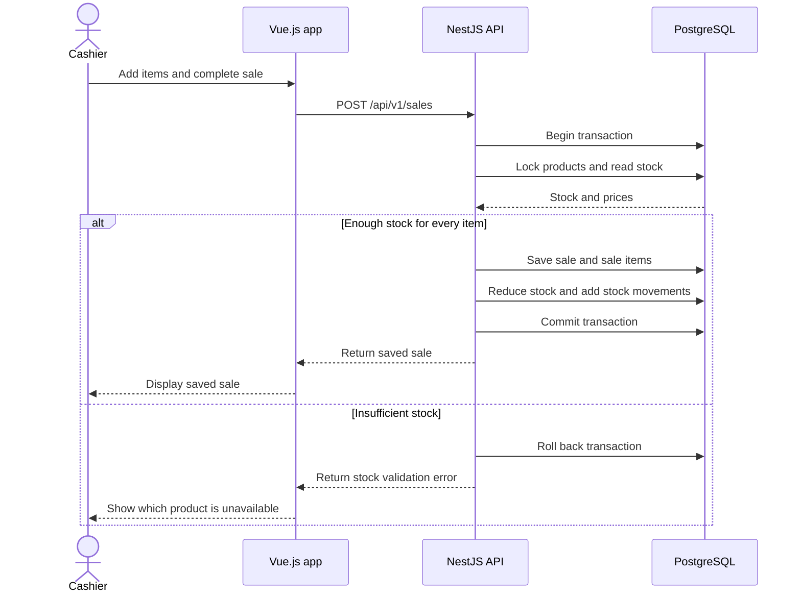

# SmartStock — Small Business Inventory & Sales Management System

## Problem

Small shop owners and employees often track products, stock levels, and daily sales manually using notebooks or spreadsheets, which can lead to inaccurate inventory and missing sales records. This matters because stock errors, unexpected shortages, and incorrect sales calculations can waste money and make it difficult for small businesses to understand their performance.

## Users and roles

- **Shop Owner:** Manages products, stock adjustments, low-stock thresholds, and views sales reports and stock history.
- **Employee/Cashier:** Views products and stock, and records customer sales.

### Permission rules

All data belongs to a single shop. Permissions are enforced by the backend, not only by hiding buttons in the frontend.

| Action | Shop Owner | Employee/Cashier |
|---|---|---|
| Log in with own account | Yes | Yes |
| Create, edit, deactivate products | Yes | **No** |
| Set low-stock thresholds | Yes | **No** |
| Adjust stock manually | Yes | **No** |
| View products and current stock | Yes | Yes |
| Record a sale | Yes | Yes |
| View sale details | Yes | Yes (own sales only) |
| View sales summaries | Yes | **No** |
| View stock movement history | Yes | **No** |
| View low-stock alerts | Yes | **No** |
| Edit or cancel a recorded sale | **No** (backlog) | **No** |

Recorded sales are never edited. Sale cancellation is in the backlog, and when added it will be owner-only.

## User stories (8)

**1. Login and roles**

As a **Shop Owner or Employee/Cashier**, I want to log in with my own account and only access the features my role allows, so that the shop's data stays secure.

**Accepted when:**
- A user can log in with valid credentials, and invalid credentials are rejected with an error message.
- Passwords are stored as secure hashes, not plain text.
- Unauthenticated users cannot access protected features.
- Actions outside a user's role (see permission rules) are rejected by the backend, even when the API is called directly.

**2. Product management**

As a **Shop Owner**, I want to add, update, and deactivate products so that I can keep my product catalog accurate.

**Accepted when:**
- A product can be created with a name, SKU, selling price, and initial quantity.
- Required fields are validated, and invalid prices or duplicate SKUs are rejected.
- Deactivated products cannot be included in new sales.

**3. View products and stock**

As an **Employee/Cashier**, I want to view product details and current stock levels so that I can check availability before making a sale.

**Accepted when:**
- The user can view a product's name, SKU, selling price, and available quantity.
- Deactivated products are clearly identified and cannot be sold.
- Stock quantities reflect completed sales and stock adjustments.

**4. Record a sale (with automatic stock update)**

As an **Employee/Cashier**, I want to record a sale containing multiple products so that purchases are processed accurately and stock updates automatically.

**Accepted when:**
- A sale can contain multiple products and quantities, and the system calculates line subtotals and the total correctly.
- A sale cannot be completed when a requested quantity exceeds available stock.
- Completing a sale reduces the stock of every sold product and records a stock movement for each.
- If any part of a sale fails, the sale, stock changes, and stock movements are not partially saved (single database transaction).

**5. Manual stock adjustments**

As a **Shop Owner**, I want to adjust stock quantities manually so that I can correct inventory after counting physical products.

**Accepted when:**
- The owner can increase or decrease stock quantities.
- Every adjustment records the product, quantity change, reason, user, and timestamp.
- An adjustment cannot result in negative stock.

**6. Low-stock threshold and alerts**

As a **Shop Owner**, I want to set a low-stock threshold for each product and see which products are at or below it so that I can restock before they run out.

**Accepted when:**
- A threshold can be configured for each product.
- Any product whose stock is at or below its threshold appears in the owner's low-stock alert list.
- A product leaves the list automatically once its stock is above the threshold again.
- The alert list reflects changes from both sales and manual adjustments.

**7. Sales summary and history**

As a **Shop Owner**, I want to view sales for a selected date range, and the details of each sale, so that I can understand performance and review transactions.

**Accepted when:**
- The owner can select a start date and end date.
- The system displays the number of sales and total revenue for that period, calculated from recorded transactions.
- The owner can view the list of sales with dates, totals, and transaction identifiers.
- Selecting a sale displays its products, quantities, unit prices, totals, and the employee who recorded it.

**8. Stock movement history**

As a **Shop Owner**, I want to view stock movement history so that I can understand why a product's quantity changed.

**Accepted when:**
- The owner can view stock movements for a selected product.
- Each movement displays the quantity change, movement type, reason, responsible user, and timestamp.
- The history includes movements caused by sales and by manual adjustments.

## Which story did you cut, and why?

I cut **Search and filter products** (originally story 10). A small shop's catalog is short enough to scroll, so search is a convenience, not part of the core loop of selling, updating stock, and reviewing. It can be added later without changing the data model, since it only reads existing Product fields.

I also moved **receipt printing**, **USD/KHR dual currency**, and **product categories** out of the MVP. They add real complexity (exchange rate storage, print layout, a new entity) without changing whether the system can keep stock accurate.

## MVP scope

The MVP is stories 1 to 8: log in, manage products, view stock, record a sale with a transactional stock update, adjust stock, see low-stock alerts, review sales, and review stock history. Prices are stored and displayed in **USD only**.

### Stretch feature

**Scheduled low-stock check.** Once a day, the system checks every active product against its low-stock threshold and prepares a low-stock report for the owner, which helps when no sale happened that day to surface a shortage. It builds directly on story 6, so the two stay together: if story 6 is dropped, the stretch feature is dropped too.

### Backlog (not promised; consider after M4)

- Receipt printing and receipt reprinting
- USD/KHR dual currency with a configurable exchange rate
- Search and filter products
- Product categories
- Employee account management (in the MVP, the owner account and employee accounts are created by a seed script)
- Dashboard overview
- Payment methods
- Discounts
- Cancel an eligible sale (owner only)
- Export sales reports (CSV)
- Product image management

## Entities (5)

| Entity | Main attributes | Relations |
|---|---|---|
| User | id, name, email, passwordHash, role, active | A user can record many sales and stock movements. |
| Product | id, name, SKU, sellingPrice, stockQuantity, lowStockThreshold, active | A product can appear in many sale items and stock movements. |
| Sale | id, saleDate, totalAmount, createdBy | A sale belongs to one user and contains many sale items. |
| SaleItem | id, saleId, productId, quantity, unitPrice, subtotal | Each sale item belongs to one sale and references one product. |
| StockMovement | id, productId, userId, movementType, quantityChange, reason, createdAt | Each stock movement references one product and the user responsible for the change. |

**Implementation notes:**
- Low-stock alerts are derived by comparing `stockQuantity` with `lowStockThreshold`, so no separate alert table is needed in the MVP.
- Unit prices are copied into SaleItem at sale time so that later price changes do not alter past sales.

## Tech stack

- **Frontend:** Vue.js 3 with TypeScript, Vue Router, and Pinia
- **Backend:** NestJS with TypeScript and JWT authentication
- **Database:** PostgreSQL
- **ORM:** Prisma (schema and migrations with Prisma Migrate)
- **API documentation:** Swagger (OpenAPI) via `@nestjs/swagger`
- **Containerization:** Docker and Docker Compose for the API, database, and frontend
- **Testing:** Vitest for frontend unit tests and Jest for backend tests

## Architecture

The project uses NestJS feature modules for authentication, users, products, sales, and stock. Business rules are implemented in services, while PostgreSQL stores persistent data and Prisma migrations track schema changes.

The frontend uses Vue feature folders and reusable components, with props passing data down and events communicating user actions up. Pinia is used for shared client-side state when needed. The backend exposes a versioned REST API under `/api/v1`, documented with Swagger, with validation, role-based authorization, pagination where appropriate, and transaction handling for sales and stock updates.

## Sequence diagram

### Recording a sale

## Repository

[https://github.com/haimonyoudom/smartStock](https://github.com/haimonyoudom/smartStock)
